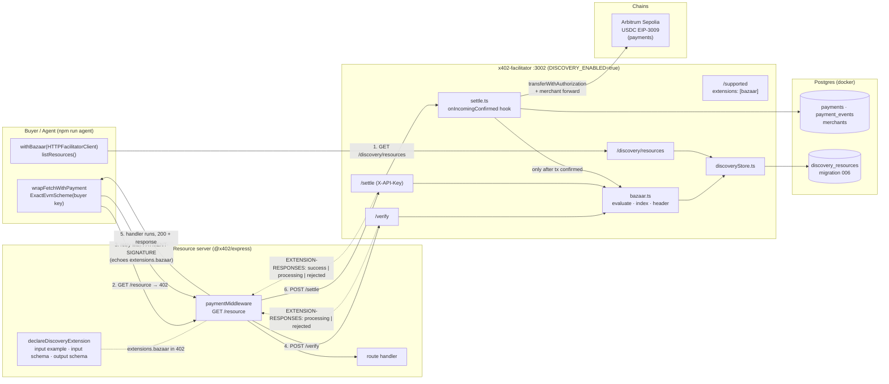

# Bazaar discovery: architecture

How the facilitator's [`bazaar` extension](https://docs.x402.org/extensions/bazaar) fits together with a
resource server that sells through it. The seller shown is a generic `@x402/express` resource server; any x402
resource server that declares the extension works the same way.

## Enabling

Discovery is off unless `DISCOVERY_ENABLED=true`. With it unset the facilitator behaves exactly as it did before
the extension existed: `/supported` advertises no extensions, `/verify` and `/settle` ignore
`extensions.bazaar`, no settle hook runs, and `GET /discovery/resources` is a 404.

To turn it on:

1. Apply migrations 006 and 007 to an existing database (a fresh Docker database picks them up on init):
   `pnpm migrate migrations/006_discovery_resources.sql` and `pnpm migrate migrations/007_discovery_origins.sql`.
   They build on the merchant tables from 002 and 003 (`merchants.approved`), which any database that runs the
   merchant dashboard already has; without 003 the catalog returns 503.
2. Register the origin each selling merchant serves its resources from:
   `pnpm discovery origins add <merchant> <origin>`, for example `https://api.example.com`. Nothing is catalogued
   for a merchant with no registered origin.
3. Set `DISCOVERY_ENABLED=true` alongside `DATABASE_URL` and restart.

Enabled without a database, the facilitator still validates declarations but has nowhere to index them, so it does
not advertise `bazaar` and reports valid declarations as `rejected` (`discovery index unavailable`).

## Components



- **Buyer / agent**: any x402 client. Uses `withBazaar(new HTTPFacilitatorClient(...))` from `@x402/extensions`
  to read the catalog and `wrapFetchWithPayment` from `@x402/fetch` to pay.
- **Seller**: an `@x402/express` resource server. Declares how its paid route is called with
  `declareDiscoveryExtension`; the declaration rides along in every 402 it returns.
- **Facilitator**: this repository. `/verify` and `/settle` validate the declaration echoed in the payment payload
  (`src/bazaar.ts`), the settle hook indexes it once the payer's transfer has confirmed (`src/settle.ts`),
  and `GET /discovery/resources` serves the catalog (`src/discoveryStore.ts`, migration
  `006_discovery_resources.sql`).
- **Chains**: payments settle in USDC on the network the facilitator is configured for (Arbitrum Sepolia in
  development).

## One discovered, paid call

```mermaid
sequenceDiagram
  autonumber
  participant Agent as Buyer agent
  participant Fac as Facilitator :3002
  participant DB as Postgres
  participant Seller as Resource server
  participant Chain as Arbitrum Sepolia

  Agent->>Fac: GET /discovery/resources?type=http
  Fac->>DB: SELECT discovery_resources
  Fac-->>Agent: items[] (resource, accepts, extensions.bazaar.info)

  Agent->>Seller: GET /resource
  Seller-->>Agent: 402 PAYMENT-REQUIRED (accepts, extensions.bazaar {info, schema})

  Note over Agent: sign EIP-3009 authorization<br/>echo extensions.bazaar into PaymentPayload
  Agent->>Seller: GET /resource + PAYMENT-SIGNATURE

  Seller->>Fac: POST /verify {paymentPayload, paymentRequirements}
  Note over Fac: evaluateBazaarDeclaration()<br/>spec checks → info vs schema → URL/accepts
  Fac-->>Seller: 200 isValid + EXTENSION-RESPONSES {bazaar: processing}

  Seller->>Seller: route handler runs
  Seller-->>Agent: 200 response

  Seller->>Fac: POST /settle (X-API-Key)
  Note over Fac: evaluateBazaarDeclaration() starts,<br/>not awaited: settlement does not wait on it
  Fac->>DB: claim nonce (advisory lock)
  Fac->>Chain: transferWithAuthorization(buyer → facilitator)
  Chain-->>Fac: receipt + Transfer event
  Fac->>DB: status = incoming_complete
  Note over Fac: onIncomingConfirmed hook → verdict on the echo<br/>origin registered to this merchant?
  Fac->>Seller: GET/HEAD resource.url (no payment, no redirects, body unread)
  Seller-->>Fac: 402 PAYMENT-REQUIRED (the seller's own declaration)
  Fac->>DB: check registration FOR SHARE, UPSERT discovery_resources from the seller's copy
  Note over Fac: the hook waits ≤ DISCOVERY_SCHEMA_TIMEOUT_MS for this;<br/>past that it reports processing and finishes after the response
  Fac->>Chain: transfer(merchant share)
  Fac-->>Seller: 200 success, tx hashes + EXTENSION-RESPONSES {bazaar: success}
  Seller-->>Agent: PAYMENT-RESPONSE header (buyer never sees EXTENSION-RESPONSES)
```

1. The agent lists the catalog. Each item carries the resource URL, the price terms (`accepts`), and the seller's
   declaration (`extensions.bazaar.info`): method, example query parameters, output example.
2. The agent calls the route and receives a 402 whose `PAYMENT-REQUIRED` header repeats the declaration.
3. The client SDK signs an EIP-3009 authorization and echoes the declaration into `PaymentPayload.extensions`.
   This echo is how the declaration reaches the facilitator: the seller forwards the whole payload to `/verify`.
4. `/verify` validates the declaration (spec invariants, `info` against its own JSON Schema, absolute resource URL,
   well-formed `accepts`) and reports the outcome to the seller in the `EXTENSION-RESPONSES` header
   (`processing` or `rejected` with a reason). Payment verification is unaffected by the outcome.
5. The seller does the work and answers the buyer.
6. `/settle` starts validating the declaration and, without waiting for it, submits `transferWithAuthorization`.
   Once the receipt and the expected `Transfer` event are in, the settle hook takes the verdict, asks the seller for
   its own 402, and upserts `discovery_resources` from the seller's copy (see "Where a catalog entry comes from"
   below). The header reports `success`, or `processing` if that did not finish within the hook's budget. A declaration attached to a payment that never lands is never
   indexed, and gets no verdict either (see "Settlement never waits on discovery" below).

## Hardening the declaration path

Everything in `extensions.bazaar` is written by the paying client, and `/verify` is
unauthenticated. Three limits keep that from being a free lever on the facilitator:

**The JSON Schema step runs in a worker under a hard timeout** (`src/schemaGuard.ts`).
`validateDiscoveryExtension` compiles the declaration's own `schema` with Ajv and runs it
against the declaration's own `info`. Ajv turns a `pattern` into a plain `RegExp`, which
carries no linear-time guarantee and no timeout, so `{"pattern": "^(a+)+$"}` matched
against `"aaaa…b"` costs time exponential in the length of the data. Node is
single-threaded: on the main thread that is not a slow request, it is the whole process
frozen, and the rate limiter cannot answer either. The validation therefore happens on a
worker thread that can be killed, and overrunning `DISCOVERY_SCHEMA_TIMEOUT_MS` (250ms by
default) kills it. One long-lived worker serves every request, since a worker busy
backtracking cannot serve anything else anyway.

A timeout and a saturated queue both report `processing`, never `rejected`: no verdict was
reached, and a slow match can equally mean a hostile regex or a starved CPU. Claiming the
declaration is bad would condemn honest sellers whenever the box is busy, and it buys
nothing — the row is not indexed either way and the payment is untouched. Worker startup
(~100ms to spawn the thread and load the SDK) is deliberately not charged against the
validation budget, for the same reason.

**Settlement never waits on discovery.** The validator queue is
shared with unauthenticated `/verify`, so on `/settle` the evaluation starts alongside the settlement instead of
before it, and the payer's transfer is submitted without waiting for a verdict. The verdict is awaited only in the
post-confirmation hook, which sits before the merchant forward, and only for up to `DISCOVERY_SCHEMA_TIMEOUT_MS`.
Normally it arrived long before the transfer confirmed and is reported as is (`rejected` with its reason, or
indexed and `success`). If the queue is backed up and the deadline passes, the header says `processing` and the
settlement carries on, so a saturated validator costs a settlement at most one validation budget, after the payment
has landed. `processing` keeps its spec meaning, "being catalogued asynchronously": the work is not abandoned at the
deadline but finishes after the response has gone out, and a valid declaration is indexed when its verdict lands.
Only a declaration no verdict is ever reached on (the validator saturated, or the validation timed out) is not
indexed.

The verdict is tied to the payment. If the payment fails, `/settle` sends no `bazaar` status at all, even for a
malformed declaration; while it is still pending (`settlement_pending`) the status is `processing`. Reporting a
verdict there would mean waiting on the validator for a payment that did not happen. This matches `/verify`, which
reports nothing for a payload that does not verify.

**`/verify` evaluates nothing until the payment verifies.** Schema work costs real CPU and
the route takes no authentication, so an unsigned payload must not be able to spend it.
The guard above is still what bounds the cost for a caller who can produce a valid
payment; this only removes the free path.

**`/verify` waits at most one validation budget.** Resource servers wait on `/verify` before they serve the paid
request, so it is on the payment path too. It waits for the verdict for up to `DISCOVERY_SCHEMA_TIMEOUT_MS` and
then answers `processing`, with the payment result untouched. An evaluation that fails outright also reports
`processing`, where it used to surface as a 500. The deadline bounds the response, not the queue: the abandoned job
still runs, so the queue limitation below applies unchanged.

**Resource URLs are screened** (`src/resourceUrl.ts`) against the same classes of host the
SDK already refuses for `iconUrl` — loopback, IPv4 literals, decimal- and hex-encoded
hosts — plus IPv6 literals, internal-use suffixes, bare hostnames and embedded
credentials. The resource URL is the field agents actually call, so it gets at least what
the icon gets. `DISCOVERY_ALLOW_PRIVATE_RESOURCE_URLS=true` relaxes the host rules (not
the scheme rules) for local development against a seller on localhost.

The screen runs twice: on `resource.url` before any schema work, and again on the URL that
is actually stored. The SDK derives that one as origin + the declaration's `routeTemplate`
and puts no length bound on the template, so a short `resource.url` alone says nothing
about the size of the catalogued value.

Two smaller bounds: a declaration over `DISCOVERY_MAX_DECLARATION_BYTES` (16KB) is refused
before any schema work, and `description` and `mimeType` are truncated before they are
stored, since the SDK sanitizes `serviceName`, `tags` and `iconUrl` but passes those two
through untouched. Only the `bazaar` key of the buyer's `extensions` map is republished,
not every other extension they happened to attach.

## Where a catalog entry comes from: the seller's own 402

The buyer's echo cannot be catalogued. The seller SDK checks only the echoed `info` against what it advertised
(`validateExtensions` in `@x402/core`) and forwards the rest of the payload as the buyer sent it, so the echo's
`schema`, `routeTemplate` and the whole `resource` block (description, icon, MIME type) are the buyer's to write. A
buyer paying a merchant that legitimately advertises bazaar could keep `info` as advertised and rewrite that
merchant's listing.

So the echo is validated, because the spec requires it, and then set aside. Once the payment has confirmed, `/settle`
asks the seller directly:

1. The paid URL (`resource.url` from the payment) must be on an origin registered to the settling merchant. Nothing
   else is ever requested; an unregistered origin is `rejected` with no request made.
2. The request uses the declaration's method, which must be `GET` or `HEAD` (any other method is refused when the
   declaration is evaluated, on `/verify` too), carries no payment, no credentials and no cookies, does not follow
   redirects, and is bounded by `DISCOVERY_SELLER_TIMEOUT_MS` (default 2000).
3. Only the status line and headers are read. The body is cancelled unread.
4. The seller's 402 must carry a `PAYMENT-REQUIRED` header. A timeout, a network error, a redirect, any status other
   than 402, or a missing or undecodable header is "no verdict": `processing`, nothing indexed, as for a validator
   timeout.
5. The decoded 402 must be `x402Version: 2`, declare `extensions.bazaar`, and list an `accepts` entry matching what
   was settled on scheme, network, asset and payTo. `amount` is deliberately not compared: a seller with dynamic
   pricing may quote a different amount on an unpaid request. Failing any of these is `rejected` with a fixed reason
   that never quotes what the seller sent back.
6. The seller's declaration then goes through exactly the checks the echo did (size, spec, the MCP and method
   refusals, both URL screens, its schema in the worker), and the entry is built from it: the URL is the seller's
   `resource.url` origin plus the seller's `routeTemplate`, `accepts` is the seller's matching entry (its current
   advertised price), and the description, MIME type, service metadata and declaration are the seller's. Nothing in
   the catalog comes from the echo.
7. The write checks the registration again, inside its own transaction, against the URL actually stored.

`/verify` never makes this request: it is unauthenticated, has no merchant, and its verdict on a valid declaration
stays `processing`.

**What the outbound request exposes.** The facilitator makes one request per indexed settlement, only to registered
origins. Two residual risks remain, both narrow:

- **A registered origin whose DNS points somewhere private.** The resource-URL screen works on names, not resolved
  addresses, so an origin whose name resolves to a private address would be requested. Registration is an operator
  decision and the response body is never read, so this reveals no content, but an operator should only register
  origins they would be happy for the facilitator to call.
- **Path probing on the merchant's own host.** The origin is checked but the path is the buyer's: the request goes to
  the payment's `resource.url`. A buyer paying a merchant can therefore make the facilitator `GET` or `HEAD` any path
  on that merchant's registered origin. The status and headers that come back stay in the facilitator's logs; what
  leaves is the bazaar status and a fixed `rejectedReason`, sent to the merchant's server in `EXTENSION-RESPONSES`,
  which the resource server may pass on. Nothing about the probed response is quoted in it. The reach is one
  request per paid settlement, registered origins only, `GET`/`HEAD` only, no credentials, no redirects, body unread.

## What the catalog does and does not attest

A catalog row records that **a payment confirmed onchain to the facilitator, settled under the API key of the
merchant an operator registered for the resource's origin, and that this origin's own 402 carried the catalogued
declaration.** That is all it records.

The buyer's `PaymentPayload` carries a declaration and a `resource.url`, both of which the buyer can edit; on their
own they prove nothing, and a buyer could point them at anyone's domain. So the facilitator takes neither the URL's
nor the echo's word for it. It asks only a registered origin for its 402, catalogues what that 402 says, and indexes a
resource only when the catalogued URL's origin is registered to the merchant whose API key settled the payment
(`discovery_merchant_origins`, migration 007). The registration is the operator's statement that this merchant serves
that origin. The facilitator still does not prove domain ownership itself.

Three rules hold the catalog together:

- **One merchant per origin, registered by the operator.** `pnpm discovery origins add <merchant> <origin>` registers
  an origin; it is refused, naming the current holder, if another merchant already holds it. A settlement whose
  catalogued URL is on an origin not registered to the settling merchant is reported as
  `rejected` / `resource origin not registered for this merchant` and indexes nothing. The check uses the canonical
  URL, so a lookalike `resource.url` does not get around it, and a URL that does not parse fails closed. The check
  runs inside the catalog write's own transaction, holding `FOR SHARE` on the registration row, so a concurrent
  `origins move` or `remove` either waits for the write (and its cleanup then removes the row) or lands first and the
  write sees the new holder and does nothing. A merchant with no registered origin gets nothing indexed. `/verify` is unauthenticated and so has no merchant to check
  against: there a valid declaration is reported `processing`, and only `/settle` can reject it on these grounds.
  Reads follow the same rule: `GET /discovery/resources` serves only entries on an origin registered to their owner,
  and only while that owner is enabled and approved, the same bar `/settle` sets. Disabling a merchant
  (`pnpm merchants disable`, or the dashboard) hides its entries at once; they are kept, and re-enabling brings them
  back.
  Entries written before migration 007 are kept, not deleted, but are not served until their origin is registered
  to their owner, and an entry whose origin the backfill could not normalize is never served.
- **Catalog entries follow their origin's registration.** A trigger on `discovery_merchant_origins` keeps them in
  line, whichever tool changes the registration:
  - **Registering** an origin (`origins add`) removes any entries on it held by other merchants.
  - **Moving** it to another merchant (`pnpm discovery origins move <origin> <merchant>`) removes the previous
    holder's entries; the new holder's resources are catalogued again on its next settlement.
  - **Removing** it (`pnpm discovery origins remove <origin>`), or deleting the merchant (`pnpm merchants delete`,
    which cascades to its registrations), removes every entry on it.

  Each `pnpm discovery origins` command prints how many entries it removed. `pnpm discovery delete <url> [toolName]`
  removes individual entries; the owner can index them again on its next settlement while it holds the origin.
- **First writer owns the key.** Within an origin, the merchant whose payment first indexed a `(resource, toolName)`
  pair owns the row, and settlements by any other merchant for the same key are reported as
  `rejected` / `resource claimed by another merchant`. With one merchant per origin this only arises around a move,
  and the move's cleanup clears it.
- **`accepts` is replaced, not accumulated.** Each settlement carries the single requirement the buyer chose, and the
  newest one wins, so the row always advertises the terms the resource most recently settled on. Accumulating would
  leave superseded prices discoverable, and an agent reading a stale entry would sign an authorization the resource
  server's own 402 no longer accepts. A row therefore shows one requirement rather than every network a seller
  supports; filtering by `network`, `scheme` or `payTo` matches against it. Under this facilitator's fee-split model
  `payTo` is always the facilitator's own address (`/verify` rejects anything else), so filtering on it does not
  narrow results by seller: it matches every entry or none.

## Known limitations

Two gaps are known and deliberately not yet closed. Both affect how reliably a declaration makes it into the catalog
under load. Neither can hold up a payment for longer than `DISCOVERY_SCHEMA_TIMEOUT_MS`: that is the most a saturated
validator adds to `/verify`, and to the settle hook after the payer's transfer has landed.

**A declaration no verdict is reached on is lost.** When the schema validator is saturated or a validation times
out, the declaration is reported `processing` and the settle carries on: the payment confirms and the nonce is
consumed. A verdict that merely arrives after the hook's deadline is still indexed once it lands, but a declaration
the validator never rules on is not, and nothing persists it for a retry; the seller has to settle another payment
carrying the declaration for it to be catalogued. Late indexing also lives only in memory, so a restart between the
response and the verdict loses that one entry the same way. Closing this means storing the declaration beside the payment row and teaching the recovery worker
(`src/recovery.ts`) to index it, which is a schema change plus a worker change. A small, honest declaration on an idle
facilitator does not hit this path; a third-party declaration under load can.

**The schema validator queue is shared across trust boundaries.** One worker and one 32-deep queue
(`MAX_QUEUE_DEPTH` in `src/schemaGuard.ts`) serve both unauthenticated `/verify` and authenticated `/settle`.
`/verify` does not consume the nonce, so a single validly signed payload carrying a declaration with a backtracking
`pattern` can be replayed against `/verify` to keep the queue full. Each replay costs the facilitator up to
`DISCOVERY_SCHEMA_TIMEOUT_MS` of worker time, and declarations on real settlements arriving meanwhile get
`unavailable` or time out, are reported `processing`, and are then lost as described above. Honest
`/verify` calls meanwhile wait out their deadline and report `processing`. Payments go through, each delayed by at
most `DISCOVERY_SCHEMA_TIMEOUT_MS` per call. The rate limiter is the only thing bounding the queue today.
The remedy (separate queues per trust level, or a per-caller budget) is an open design decision.

**Only GET and HEAD HTTP resources are catalogued.** An MCP declaration is rejected with `mcp declarations are not
catalogued yet`: an MCP tool's terms come back in a tool result, not an HTTP response, so there is no seller copy to
check the buyer's echo against. A declaration whose `info.input.method` is anything but `GET` or `HEAD` is rejected
with `only GET and HEAD resources are catalogued yet`, because the facilitator probes the seller with that method and
the buyer chooses it. Both are refusals rather than `processing`, since no later step would ever index them. MCP, and
body-type resources, can follow once each has a safe way to obtain the seller's own declaration.

One consequence of the origin model is deliberate:

**One origin cannot front several merchants.** A marketplace serving many merchants behind a single origin cannot be
represented, since the path is not part of an origin and each origin belongs to exactly one merchant. That is a
trade, not an oversight: loosening a one-merchant-per-origin rule later is a trivial migration, tightening it after
data has violated it is not.

## Files

| Concern | File |
|---|---|
| Declaration validation, indexing, `EXTENSION-RESPONSES` | `facilitator/src/bazaar.ts` |
| Worker-isolated, timed-out JSON Schema validation | `facilitator/src/schemaGuard.ts` |
| Resource URL screening (SSRF) | `facilitator/src/resourceUrl.ts` |
| Fetching the seller's own 402 and building the entry from it | `facilitator/src/sellerDeclaration.ts` |
| Catalog table access | `facilitator/src/discoveryStore.ts` |
| Table definitions | `facilitator/migrations/006_discovery_resources.sql`, `facilitator/migrations/007_discovery_origins.sql` (origin registrations and the cascade trigger) |
| Post-confirmation hook | `facilitator/src/settle.ts` (`SettleHooks.onIncomingConfirmed`) |
| Operator tool: catalog entries and origin registrations | `facilitator/scripts/manage-discovery.ts` (`pnpm discovery`) |
| Routes: `/supported`, `/verify`, `/settle`, `/discovery/resources` | `facilitator/src/server.ts` |
| Carrying `resource` and `extensions` through parsing | `facilitator/src/x402.ts`, `facilitator/src/types.ts` |
